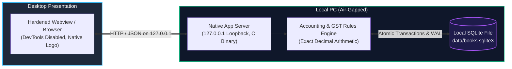

<div align="center">

  

  # Independent Books ⚡

  ### **The Open-Source, Air-Gapped Tally Prime Alternative**
  *Fast, keyboard-driven double-entry bookkeeping with 100% offline SQLite storage, zero subscriptions, and zero telemetry.*

  <p align="center">
    <a href="https://github.com/zoro-roronoa74/independent-books/stargazers"></a>
    <a href="LICENSE"></a>
    <a href="https://independent-books.pages.dev/downloads/IndependentBooksSetup.exe"></a>
    
    
    
  </p>

  <p align="center">
    <a href="https://independent-books.pages.dev"><b>🌐 Official Website</b></a> •
    <a href="https://independent-books.pages.dev/downloads/IndependentBooksSetup.exe"><b>⬇️ Download for Windows (8.6 MB)</b></a> •
    <a href="#-quick-start"><b>⚡ Quick Start</b></a> •
    <a href="#-key-features"><b>✨ Features</b></a> •
    <a href="#-keyboard-shortcuts"><b>⌨️ Shortcuts</b></a> •
    <a href="#-architecture--privacy"><b>🔒 Security</b></a> •
    <a href="CONTRIBUTING.md"><b>🤝 Contributing</b></a>
  </p>

  ---

  > ⭐ **Star this repository** if you believe independent businesses and accountants deserve high-performance, private, free accounting software without annual subscription paywalls!

</div>

---

## 💡 Why Independent Books?

Most modern accounting software forces businesses into expensive cloud subscriptions, locks ledgers behind proprietary database formats, and uploads sensitive financial transactions to third-party servers.

**Independent Books** is a clean-sheet, open-source accounting engine built for speed, privacy, and keyboard familiarity:

| Feature | **Independent Books** ⚡ | **Tally Prime** | **Cloud SaaS (QuickBooks / Zoho)** |
| :--- | :---: | :---: | :---: |
| **Licence Cost** | **Free Forever (MIT)** | ₹22,500+ / year | \$30 – \$90 / month |
| **Data Privacy** | **100% Local SQLite** | Proprietary `.900`/`.tsf` | Multi-tenant cloud servers |
| **Air-Gapped Operation** | **Strict Loopback `127.0.0.1`** | Offline local | Requires active internet |
| **Keyboard Hotkeys** | **Full Tally Muscle Memory (<kbd>F2</kbd>–<kbd>F10</kbd>)** | Full hotkeys | Mouse-heavy web UI |
| **Balance Sheet & P&L** | **Two-Sided Presentation (Left/Right)** | Two-sided | Single stacked columns |
| **Stock Valuation** | **Moving Weighted Average** | Configurable | Periodic / FIFO |
| **Data Portability** | **Standard SQLite + Open JSON/XML** | Proprietary XML/ODBC | Vendor export lock-in |
| **Executable Footprint** | **~8.6 MB Native C Binary** | ~45+ MB installer | Heavy browser tabs |
| **Telemetry & Beacons** | **Zero Telemetry** | License telemetry | Continuous user tracking |

---

## ✨ Key Features

### 1. 📊 Real-Time Gateway KPI Dashboard
- Instant live cards for **Today's Sales**, **Today's Collections**, **Due from Customers (Debtors)**, **Due to Suppliers (Creditors)**, and **This Month's Profit**.
- Interactive vector sales chart switchable between **Week**, **Month**, and **Year**.
- One-click drill-down directly into the **Day Book**.

### 2. 🧾 Complete Double-Entry Voucher Engine
- Full support for standard accounting and inventory vouchers:
  - **F4**: Contra (Cash & Bank transfers)
  - **F5**: Payment (Bank & Cash outflows)
  - **F6**: Receipt (Customer collections)
  - **F7**: Journal (Adjustment & transfer entries)
  - **F8**: Sales (Invoices with stock items & GST)
  - **F9**: Purchase (Supplier bills & inventory inward)
  - **F10**: Other Vouchers (Credit Note, Debit Note, Physical Stock)
- **Exact Decimal Arithmetic**: Monetary calculations run with exact Python `Decimal` / integer cents — never floating-point guesses.

### 3. 🔍 In-Place Substring Master Search
- Instant, non-intrusive floating dropdown for all master fields (Ledgers, Items, Godowns, Units).
- Matches anywhere in the name or alias with auto-highlight and overwrite-on-type ergonomics.

### 4. ⚖️ Two-Sided Financial Statements
- **Balance Sheet**: Traditional Tally layout with **Capital & Liabilities on Left** and **Property & Assets on Right**. Shows real Differences in Opening Balances instead of fabricated plugs.
- **Profit & Loss Account**: **Trading Expenses & Opening Stock on Left**, **Sales & Closing Stock on Right**, with exact Nett Profit reconciliation.

### 5. 🇮🇳 State-Aware GST Calculation Engine
- Automatically determines taxation mode based on party state vs company state:
  - **Intra-State**: 50/50 split between **CGST** and **SGST**.
  - **Inter-State**: Full rate allocated to **IGST**.
- Handles 0% exempt items, reverse charges, and item-level HSN/SAC codes.

### 6. 📁 Data Portability & Bulk Excel Import
- **One-Click Backup**: Exports all companies into a portable, human-readable, schema-validated JSON backup.
- **Bulk Excel/CSV Templates**: Download clean master templates and import hundreds of ledgers and stock items in a single atomic transaction.
- **Tally XML Interoperability**: Import and export masters and vouchers via standard XML bundles.

---

## ⚡ Quick Start

### Option 1: Standalone Windows Installer (Recommended)
1. Download the latest installer: **[IndependentBooksSetup.exe (8.6 MB)](https://independent-books.pages.dev/downloads/IndependentBooksSetup.exe)**
2. Run the installer. A Desktop shortcut and Start Menu entry will be created.
3. Launch **Independent Books** — it starts in a hardened, distraction-free application window with its own isolated local runtime.

> **Note on Windows SmartScreen**: Because Independent Books is a community-driven open-source project without an expensive corporate code-signing certificate, Windows SmartScreen may show an *"Unknown Publisher"* warning. Click **More info → Run anyway**. You can verify the official SHA-256 hash below:
> ```text
> SHA-256: 85cfca2c06cc654e23b410e302946975792b0503e9793568e7e9122f2b1208c7
> ```

---

### Option 2: Run from Source in 30 Seconds

Independent Books runs directly on standard Python 3.9+ with zero required external PyPI packages for core accounting!

```bash
# 1. Clone the repository
git clone https://github.com/zoro-roronoa74/independent-books.git
cd independent-books

# 2. Launch the application server
python app_server.py --port 3543
```
Open **`http://127.0.0.1:3543`** in your browser.

#### Running on macOS:
```bash
chmod +x launch_mac.sh
./launch_mac.sh
```

---

## ⌨️ Keyboard Shortcuts

Designed for high-speed touch typists who never want to reach for a mouse:

| Shortcut | Action | Description |
| :--- | :--- | :--- |
| <kbd>Enter</kbd> | **Accept / Next Field** | Commits field value and advances focus to the next field |
| <kbd>Esc</kbd> | **Back / Quit** | Cancels current input or returns to the previous menu level |
| <kbd>Ctrl</kbd> + <kbd>A</kbd> | **Quick Accept** | Instantly saves the current voucher or master from any field |
| <kbd>Alt</kbd> + <kbd>G</kbd> | **Go To** | Universal fuzzy navigation search to jump anywhere in the app |
| <kbd>F2</kbd> | **Change Date** | Change current voucher or session entry date |
| <kbd>Alt</kbd> + <kbd>F2</kbd> | **Period Filter** | Set From / To date range for financial reports |
| <kbd>F3</kbd> | **Select Company** | Switch between open companies |
| <kbd>F4</kbd> | **Contra Voucher** | Bank deposits, withdrawals, and cash contra vouchers |
| <kbd>F5</kbd> | **Payment Voucher** | Record outgoing payments to suppliers and expenses |
| <kbd>F6</kbd> | **Receipt Voucher** | Record incoming customer payments and receipts |
| <kbd>F7</kbd> | **Journal Voucher** | Non-cash adjustment and transfer entries |
| <kbd>F8</kbd> | **Sales Voucher** | Customer invoicing with automatic GST computation |
| <kbd>F9</kbd> | **Purchase Voucher** | Inward inventory and supplier bill entry |
| <kbd>F10</kbd> | **Other Vouchers** | Credit notes, debit notes, physical stock verification |
| <kbd>F12</kbd> | **Configuration** | Contextual screen settings and dynamic formula manager |
| <kbd>Ctrl</kbd> + <kbd>P</kbd> | **Print / Preview** | Clean voucher invoice printing with customizable borders |

---

## 🔒 Architecture & Privacy

Independent Books operates on an **air-gapped local architecture**:



- **Loopback Enforcement**: The backend server strictly binds to `127.0.0.1`. It refuses connections from external network interfaces.
- **Zero Cloud Calls**: Zero analytics beacons, zero user trackers, zero third-party font/script CDNs during offline execution.
- **ACID Database Transactions**: Financial ledgers are committed atomically into standard SQLite database files with WAL mode enabled.
- **Compiled C Hardening**: The production Windows build compiles Python code into native x86_64 C machine code binaries using Nuitka + GCC (zero readable `.py` files in the distributed installer).

---

## 🧪 Testing & Verification

Independent Books has an exhaustive regression test suite covering ledger posting, Weighted Average Cost inventory valuation, voucher alteration rollback, and two-sided balance sheet balancing:

```bash
# Run backend accounting & security test suite
pytest tests -q

# Run frontend UI calculation & workflow suite
node tests/test_contextual_lookup.js
node tests/test_date_picker.js
node tests/test_phase1_logic.js
node tests/test_print_view.js
node tests/test_voucher_logic.js
```

All **42+ tests pass with 100% success rate**.

---

## 🗺️ Project Roadmap

- [x] Full double-entry ledger & voucher engine
- [x] State-aware GST calculation (CGST / SGST / IGST)
- [x] Two-sided Balance Sheet and Profit & Loss statement
- [x] Live Gateway KPI dashboard & interactive vector sales graph
- [x] Bulk Excel/CSV master templates import & export
- [x] Native Nuitka C binary compilation for Windows
- [x] Standalone macOS application launcher
- [ ] Direct GST Returns offline JSON export (GSTR-1 / GSTR-3B)
- [ ] Multi-currency ledger conversion & forex rate management
- [ ] Linux native packaging (AppImage / Flatpak / DEB)
- [ ] Batch & Lot tracking with expiration dates
- [ ] Optional network LAN multi-user concurrency mode

---

## 🤝 Contributing

We welcome contributions from developers, accountants, and UI designers!

- Check out our **[Contributing Guide](CONTRIBUTING.md)** to get started.
- Review our **[Code of Conduct](CODE_OF_CONDUCT.md)**.
- If you find an accounting calculation discrepancy, please submit a **[Bug Report](.github/ISSUE_TEMPLATE/bug_report.yml)**.

---

## 📄 License

Independent Books is free and open-source software licensed under the **[MIT License](LICENSE)**. You are free to use it for personal, commercial, or institutional accounting without any fees or restrictions.

---

<div align="center">
  <sub>Built with ❤️ for independent businesses and accountants worldwide.</sub>
</div>
